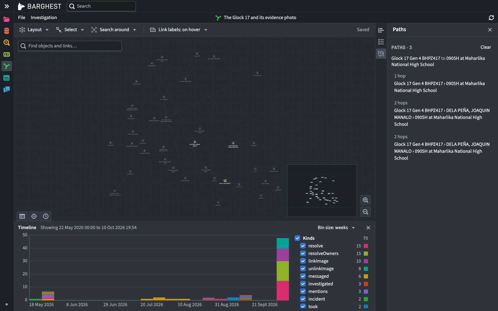
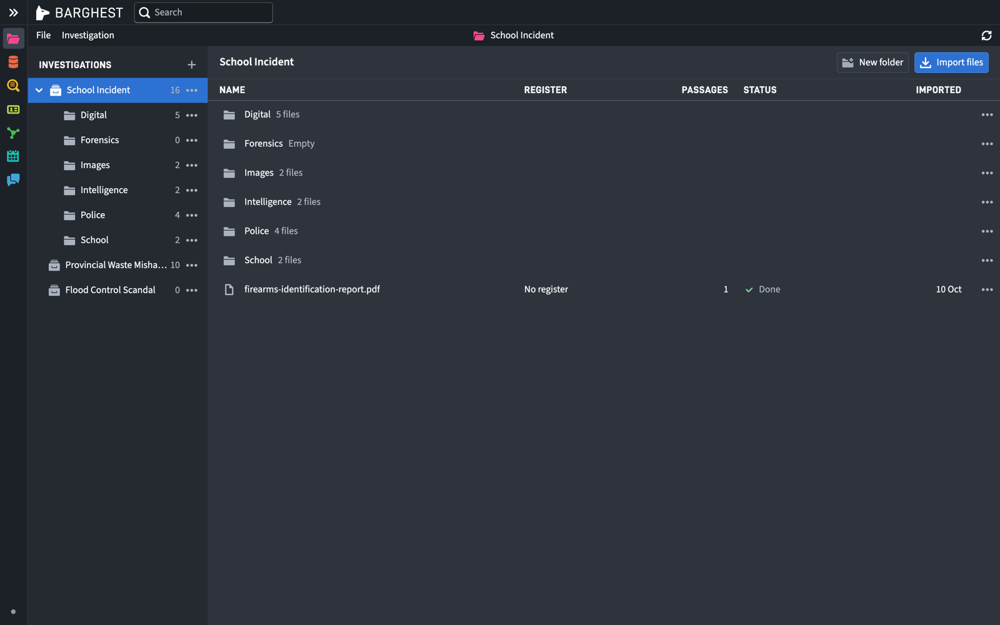
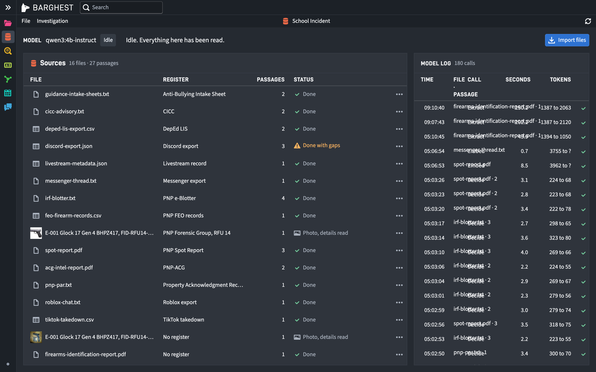
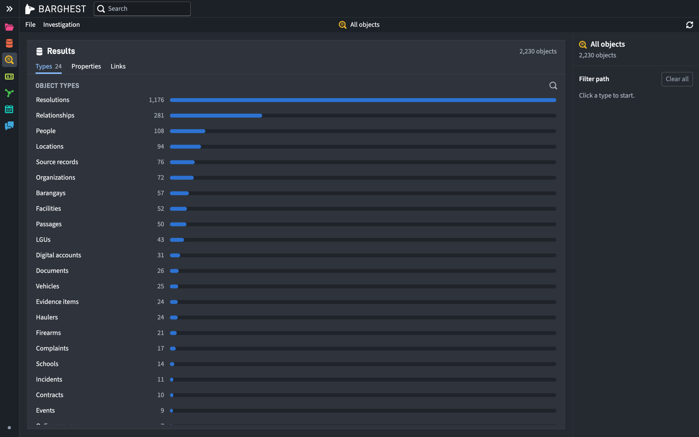
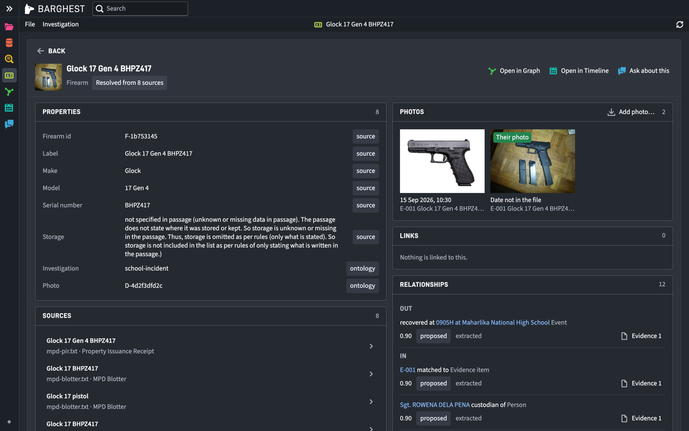
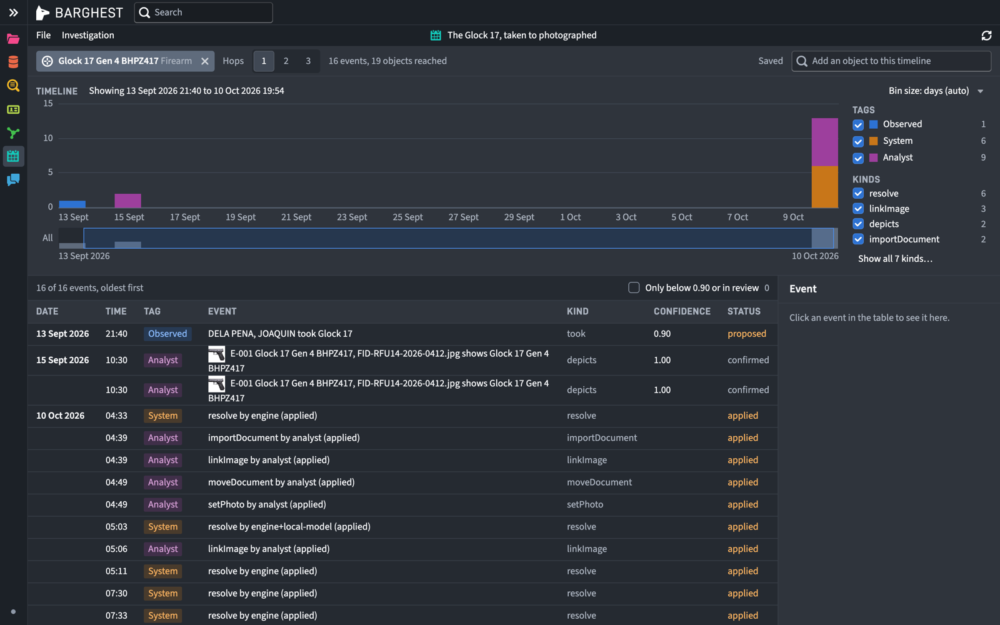
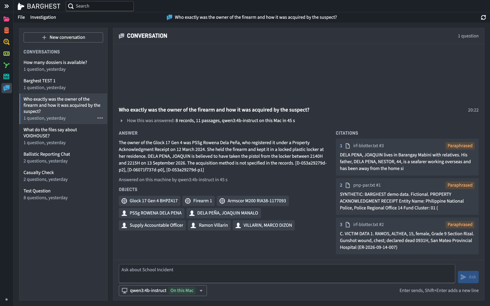

<p align="center"></p>

# BARGHEST

**A local-AI intelligence workbench. It brings the intelligence to the data, instead of sending the data to the
intelligence.**

BARGHEST turns a folder of documents and records that disagree with each other (police reports, school registers,
chat exports, contracts, audit memos) into one connected, explorable model of people, organisations, places, events
and evidence. A language model running on the analyst's own laptop reads every passage. Rules and the model together
decide which mentions are the same person or thing. The analyst then works the result in an Object Explorer, an
Entity Profile, a Graph, a Timeline and an Assistant that answers only from cited passages.

No cloud API is called at any point. After setup it runs with Wi-Fi off.

<p align="center"></p>

## Who it is for

An investigator or analyst in a public office: a police investigator, a provincial environment officer, an auditor.
They hold records that cannot leave the building, and they work where the connection cannot be trusted.

| Reason to run locally | Why it matters to these users |
|---|---|
| The records cannot leave the machine | Records of minors, police blotters, forensic reports, firearm registrations, contracts under audit. Sending them to a cloud model is a data-handling violation before it is a product choice |
| The connection cannot be trusted | Provincial offices, field inspections, a precinct during an incident |
| The cost has to be zero per document | A local office has no per-token budget. A 4B model on a laptop reads a document pack for the price of electricity |
| The evidence has to stay inspectable | Every extracted fact links back to the passage it came from, in the analyst's own database. Every model call is logged with its model, prompt hash, latency and tokens |

## The screens

| | |
|---|---|
|  **Files.** Investigations, folders, import by drag or button. |  **Data Sources.** One row per file with its register and status, beside the model's own call log. |
|  **Object Explorer.** Everything the model found, filtered by type, property and link. |  **Profile.** One object: every property tagged by where it came from, its sources, how it was resolved. |
|  **Timeline.** An object's events across hops, each with its confidence and status. |  **Assistant.** An answer from the local model, every line cited, every citation checked against the files. |

## How it works

```
data/<investigation>/sources/   PDF, TXT, CSV, JSON, MD, plus photos
        |
engine/ingest/     parse (pdfjs-dist, papaparse), split into passages, keep each file's identity
engine/extract/    local model, one passage at a time, JSON schema in Ollama's `format`, validated with zod
engine/resolve/    normalise names and handles, rule-based candidate pairs, auto-merge at 0.9 or above,
                   the local model decides the unsure pairs; every merge is recorded as a Resolution
ontology/          the ontology as code (Palantir's @osdk/maker), compiled to a typed SDK
engine/server.mjs  Palantir's @osdk/faux serves the ontology over HTTP from SQLite (node:sqlite)
engine/ask/        keyword + semantic retrieval, graph paths, one grounded answer with a citation check
src/               the workbench (React, Blueprint): Files, Data Sources, Object Explorer, Profile, Graph,
                   Timeline, Assistant
```

| What runs where | |
|---|---|
| **Local, always** | All inference: passage extraction (`qwen3:4b-instruct`), entity-resolution decisions, embeddings (`nomic-embed-text`) and the Assistant's answers, through Ollama on `localhost:11434`. Parsing, the ontology engine, the database (SQLite), search, graph and timeline |
| **Internet, once** | `pnpm install` and the two models (about 2.6 GB) |

## Run it

You need Node 22.18 or newer, [Ollama](https://ollama.com/download), [pnpm](https://pnpm.io/installation) and about
3 GB of free disk. Tested on an Apple Silicon Mac with 16 GB of memory.

```sh
git clone https://github.com/testpilot8105/barghest
cd barghest
ollama pull qwen3:4b-instruct
ollama pull nomic-embed-text
pnpm install
BARGHEST_OLLAMA=on pnpm dev       # engine on 8787, app on 5180
```

Open `http://localhost:5180`. The store starts empty. On a Mac, double-clicking `Start BARGHEST.command` does the
same, including the first-run install and model download.

### Load a demo investigation

The store starts empty, so the first thing to do is load one of the two investigations that ship with the repo.
Keep the terminal from the step above running (it is the app and the engine), and open a second terminal in the
same folder.

**1. Import the files.** Pick one investigation; `school-incident` is the better first look.

```sh
pnpm import:pack school-incident
```

This puts the 14 case files into their folders and has the local model read them, one passage at a time. It takes
about 35 minutes on an Apple Silicon Mac, and you can watch it happen: open `http://localhost:5180`, click
**Data Sources** in the left rail, and each file goes from Reading to Done as the model gets to it. The model log
on the right shows every call. If the import stops partway (laptop closed, terminal shut), run the same command
again; files already imported are skipped.

**2. Add the saved graphs and timelines.** Once the import says it is done:

```sh
pnpm seed:saved school-incident
```

This creates the ready-made views the investigation opens with ("The Glock 17 and its evidence photo", "The 72
hours", and so on) under **Graph** and **Timeline**.

**3. Look around.** Open **Object Explorer** for everything the model found, click any person or firearm for its
profile, open a saved graph, then ask the **Assistant** a question such as *Who owned the Glock 17, and how did the
suspect get it?* Every line of the answer cites a passage you can open.

The second investigation loads the same way, with `solid-waste` in place of `school-incident` (11 files, about 37
minutes). You can also import your own PDF, TXT, CSV, JSON or MD files from the **Files** screen, in either
investigation or a new one.

To start over from empty, stop `pnpm dev`, delete `data/barghest.sqlite` and the `data/files/` folder, and start it
again.

Both investigations are fully synthetic:

| Investigation | The question it answers |
|---|---|
| School incident (`data/school-incident/`, 14 files) | One subject appears under a full name, initials, a nickname and four online handles across police, school, Discord, Messenger, Roblox and TikTok records. Who is he, and what connects him to the incident? |
| Solid waste (`data/solid-waste/`, 11 files) | One hauler appears under 12 spellings across three local governments' plans, procurement awards, trip logs, environment-bureau letters and an audit memo. Which hauler serves more than one LGU, and what did the inspections say? |

Every person, school, LGU, company, account and number in the data is invented. Each pack's `ANSWERS.md` lists the
planted links, so the extraction can be checked against a known answer.

## Checks

Each starts its own throwaway engine and cleans up after itself. None needs the model.

```sh
pnpm build                                        # typecheck and production build
BARGHEST_OLLAMA=off node engine/proof-pack.mjs    # both packs import into the right folders
pnpm proof:files
pnpm proof:resolve
pnpm proof:graph
pnpm proof:investigations
npx playwright install chromium && pnpm proof:ingest   # renders a PDF in a test browser, so it needs one
```

## Measured (Apple M4, 16 GB)

| What | Result |
|---|---|
| Extraction speed | About 60 seconds per passage (about 1,200 characters) |
| School incident import | 13 files, 24 passages, 33 minutes |
| Solid waste import | 10 files, 23 passages, 37 minutes |
| Embedding | 48 passages in 10 seconds |
| Assistant answer | 20 to 45 seconds per question, with citations |
| Planted links, school incident | 34 planted: 15 found, 11 found as another kind of link, 8 missed |
| Planted links, solid waste | 36 planted: 20 found, 2 found as another kind of link, 14 missed |
| Memory | About 2 GB while a model is loaded; it unloads 2 minutes after the last call |

What it cannot do yet, and why, is in [`docs/limitations.md`](docs/limitations.md). How it was built, in
[`docs/how-it-was-built.md`](docs/how-it-was-built.md). The contract between the engine and the screens, in
[`docs/engine-api.md`](docs/engine-api.md).

## Built with

| | |
|---|---|
| Local inference | [Ollama](https://ollama.com) with Qwen3 4B Instruct and nomic-embed-text (both Apache 2.0) |
| Ontology | Palantir's open-source OSDK: `@osdk/maker` (ontology as code), `@osdk/faux` (the ontology engine, served locally), `@osdk/client` |
| Storage | `node:sqlite`, built into Node 22 |
| Reading files | `pdfjs-dist`, `papaparse`; every model output validated with `zod` |
| The app | React, Vite, TypeScript, Blueprint (components and icons), `@xyflow/react` for the graph canvas |
| Typefaces | Source Sans 3 and D-DIN, bundled under the OFL |

BARGHEST started as an entry to the AppBuildersPH Hackathon 2026, built over two days with Claude Code. The
views take their names and shape from Palantir Gotham's public product descriptions; no Palantir code beyond the
open-source OSDK packages is used.

## Licence

MIT. The bundled fonts carry their own OFL licence in `public/fonts/OFL.txt`.
